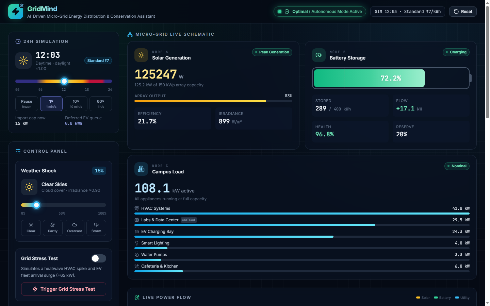
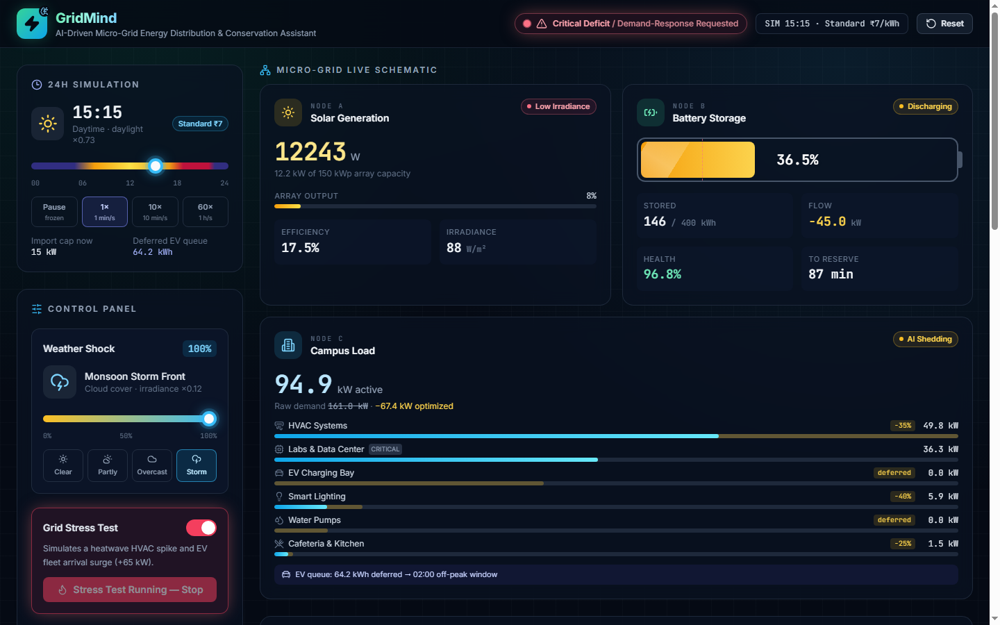
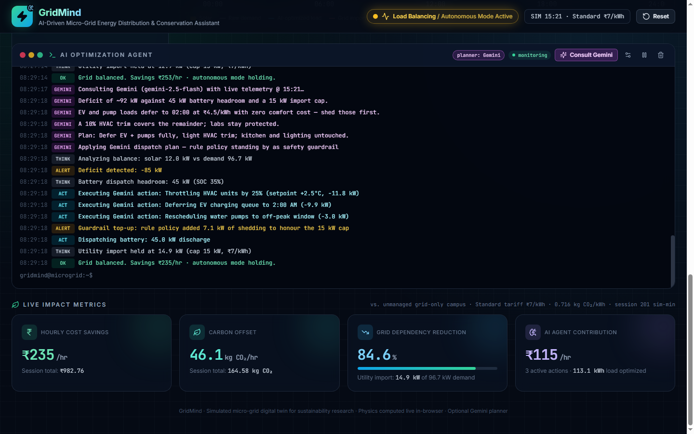
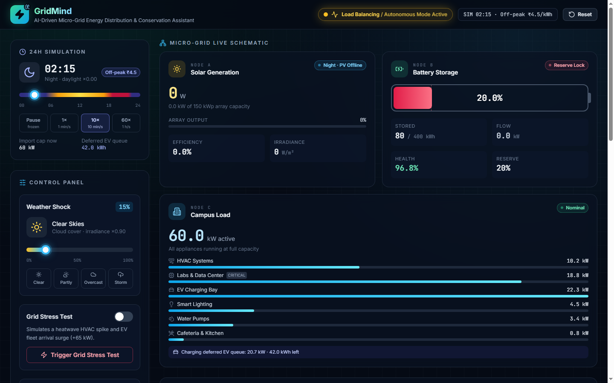
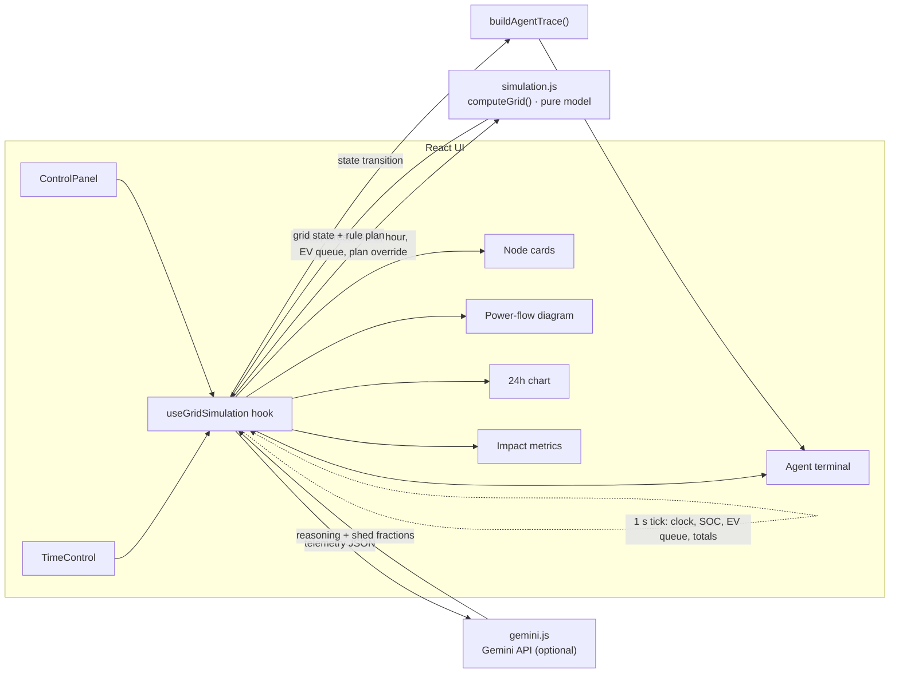

# GridMind: AI-Driven Micro-Grid Energy Distribution & Conservation Assistant

**Live demo: https://boogeyman157.github.io/PromptWars/**

GridMind is a digital twin of a campus micro-grid (solar PV, battery storage, campus load) run by an autonomous AI agent. The agent balances supply and demand in real time, shifts flexible load to cheap off-peak hours and explains every decision in a live terminal. An optional **Gemini** planner can take over load-shedding decisions, with the rule engine kept as a safety guardrail.



## Why it matters
Campus and housing-society micro-grids in India pay peak tariffs and contract-demand penalties when the sun drops or demand spikes. GridMind shows how an agent can absorb a weather shock or heatwave without buying expensive grid power: it throttles HVAC by a few percent, defers EV and pump loads to 02:00 and dispatches the battery, then reports the ₹ saved and the CO₂ avoided.

## Features
- **Live schematic**: Node A (solar), Node B (battery), Node C (campus load with a per-appliance breakdown) and an animated power-flow diagram.
- **Weather Shock and Stress Test**: a cloud-cover slider (0–100%, with presets) and a +65 kW heatwave / EV-surge stress test.
- **24-hour simulation**: a sim clock (pause, 1×, 10×, 60×) and a time slider. It drives a sunrise-to-sunset solar curve, hourly demand profiles per appliance and time-of-day tariffs (peak 18–22, off-peak 22–06). The deferred EV queue charges for real in the 02:00 off-peak window.
- **24h Energy Outlook chart**: forecast of solar, raw demand, AI-optimised load and grid import, with tariff bands and daily self-sufficiency.
- **AI Optimization Agent terminal**: streams the agent's reasoning: deficit detection, tiered load-shedding, battery dispatch, load restoration, tariff-window changes and off-peak arbitrage.
- **Gemini planner (optional)**: *Consult Gemini* (or auto-consult on every re-plan) sends live telemetry to Gemini. Gemini returns its reasoning and per-appliance shed fractions, which the app applies after clamping them to safe limits. If Gemini under-sheds, the rule policy tops it up (a "guardrail top-up").
- **Impact metrics**: hourly cost savings (₹), carbon offset (kg CO₂), grid-dependency reduction (%), the agent's own contribution, and session totals.

| Weather shock + stress test | Gemini planner | Night: deferred EV queue at off-peak |
| --- | --- | --- |
|  |  |  |

## Architecture

- `src/lib/simulation.js`: the pure physics and economics model. `computeGrid()` derives solar output, demand, shedding, battery and grid flows, status and impact from its inputs. `buildAgentTrace()` turns state transitions into agent log lines.
- `src/hooks/useGridSimulation.js`: owns state. Runs the one-second tick, re-plans when the operating point changes (weather, stress, tariff window, day phase, battery reserve, demand band) and manages Gemini consults.
- `src/lib/gemini.js`: browser-side Gemini client (`generateContent`, JSON response schema) plus validation of the returned plan.

## Run
```bash
npm install
npm run dev      # http://localhost:5173
npm run build    # production build in dist/
```
To enable Gemini, click the gear icon in the agent terminal and paste a key from [Google AI Studio](https://aistudio.google.com/apikey), or set `VITE_GEMINI_API_KEY` in `.env.local`. The key is stored in your browser's localStorage and sent only to Google. This suits a demo. For a public deployment, route the call through a small server so the key isn't exposed to visitors.

## Model assumptions
All values are editable in the `CONFIG` block of `src/lib/simulation.js`.
- 150 kWp array (0.94 derate), sunrise 06:00, sunset 18:30.
- 400 kWh battery: 45 kW discharge, 70 kW charge, 20% reserve, ₹6.2/kWh storage wear cost.
- Grid import cap: 15 kW (06:00–22:00) and 60 kW off-peak. During off-peak the agent buys grid power first and saves the battery for the next peak.
- Tariffs: ₹9.5/kWh peak (18–22), ₹7/kWh standard, ₹4.5/kWh off-peak (22–06). Export earns ₹3.2/kWh.
- Emissions: 0.716 kg CO₂/kWh (CEA India grid baseline).
- Savings are measured against an unmanaged campus that draws its full demand from the grid at the current tariff.

Demo script: [docs/DEMO.md](docs/DEMO.md).

Tech: React 18, Vite 5, Tailwind CSS 3, lucide-react, Gemini API (optional).
